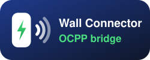
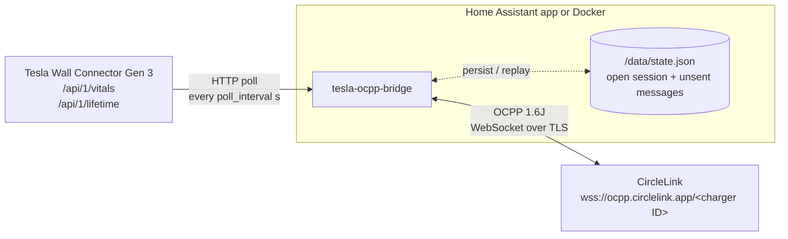

<p align="center">
  
</p>

# Tesla Wall Connector Gen 3 → OCPP bridge

[![App version][version-shield]](addon/CHANGELOG.md)
[![CI][ci-shield]][ci]
[![GitHub Activity][commits-shield]][commits]
[![License][license-shield]](LICENSE)
[![Project Maintenance][maintenance-shield]][maintainer]
[![Code style: black][black-shield]][black]
[![Linting: Ruff][ruff-shield]][ruff]
[![Buy Me A Coffee][coffee-shield]][coffee]

[](https://my.home-assistant.io/redirect/supervisor_add_addon_repository/?repository_url=https%3A%2F%2Fgithub.com%2FBrunas%2Ftesla-ocpp-bridge)

The Tesla Wall Connector Gen 3 has no OCPP support, so there is nothing to
proxy. This bridge **acts as the charge point instead**. It polls the Wall
Connector's local HTTP API and talks OCPP 1.6J to the backend:



| Wall Connector | OCPP sent |
|---|---|
| vehicle plugged in | `StatusNotification Preparing` + `StartTransaction` (meterStart = lifetime Wh) |
| contactor closed | `StatusNotification Charging` |
| charging paused/finished, still plugged | `StatusNotification SuspendedEV` |
| every `meter_value_interval` s | `MeterValues`: Energy.Active.Import.Register, Power, Current, Voltage per phase |
| vehicle unplugged | `MeterValues (Transaction.End)` + `StopTransaction` (reason EVDisconnected) |
| Wall Connector unreachable > 60 s | `StatusNotification Unavailable` |

Transaction messages are persisted in `/data/state.json` and replayed in order
after an internet outage or a restart, so sessions are not lost.

The bridge does **not** control the charger, because the Wall Connector API is
read-only. It rejects RemoteStart/Stop and SetChargingProfile.

## Before you start

1. Give the Wall Connector a fixed IP (DHCP reservation on the Asus router).
   Check that `http://<ip>/api/1/vitals` opens from the machine that will run
   the bridge.
2. In the CircleLink app, register the charger. It gives you the server URL
   `wss://ocpp.circlelink.app` and a charger ID. If it also shows a password,
   set `ocpp_password`. Keep the charger ID out of git: it lives only in the
   app's Configuration tab or your local `.env`. Note the **station name** you
   give the charger there: it is the **ID tag** (`id_tag` / `ID_TAG`), and
   it must match exactly.

## Option A: Home Assistant app (recommended)

Home Assistant runs as a VM (HA OS), so it can run apps (formerly called add-ons).

**Local app (no GitHub needed):**
1. Install the *Samba share* or *Advanced SSH & Web Terminal* app.
2. Copy the `addon/` folder to `local_apps/tesla_ocpp_bridge/` on HA (older
   apps show that share as `addons`). It is self-contained: HA builds the
   image from it.
3. Settings → Apps → *Install app* → ⋮ → *Check for updates*. The app
   appears under *Local apps*.
4. Install it, then on the *Configuration* tab fill in **Charger ID**,
   **Wall Connector address** and **ID tag** (your CircleLink station name),
   then save. Start it and watch the
   *Log* tab.

**From GitHub (one click):**

[](https://my.home-assistant.io/redirect/supervisor_add_addon_repository/?repository_url=https%3A%2F%2Fgithub.com%2FBrunas%2Ftesla-ocpp-bridge)

The button opens your own Home Assistant with this repository pre-filled.
Confirm, then install *Tesla Wall Connector OCPP Bridge* from the app store
and continue with step 4 above.

Without the button: Settings → Apps → *Install app* → ⋮ → *Repositories*,
then add `https://github.com/Brunas/tesla-ocpp-bridge`. The GitHub repo must
be public, because HA clones it.

## Option B: Docker on TrueNAS SCALE

Settings live in a local `.env` file, which git ignores:

```sh
cp .env.example .env       # then set CHARGE_POINT_ID, TWC_HOST and ID_TAG
docker compose up -d --build
docker compose logs -f
```

On TrueNAS SCALE 24.10+ you can paste the compose file as a *Custom App*
(Apps → Discover → ⋮ → Install via YAML). Remove the `build:` line there. The
app then pulls `ghcr.io/<owner>/tesla-ocpp-bridge` built by GitHub Actions
(see [CI and images](CONTRIBUTING.md#ci-and-images)). Make the GHCR package
public, or add registry credentials in TrueNAS. Relative paths don't resolve in
a pasted YAML. Put `.env` and `data/` on a dataset and use absolute paths, e.g.
`env_file: /mnt/<pool>/apps/tesla-ocpp-bridge/.env`.

The Asus router (Gnuton/Merlin) could run it via Entware Python, but it's the
weakest option, so prefer HA or TrueNAS.

## Configuration

- **Home Assistant:** the app's *Configuration* tab. HA stores it in
  `/data/options.json`, which the bridge reads.
- **Docker / local runs:** environment variables, normally from `.env`
  (template with comments: [`.env.example`](.env.example)). They override
  `options.json` if both exist.

| Env | HA option | Default |
|---|---|---|
| `OCPP_URL` | `ocpp_url` | `wss://ocpp.circlelink.app` |
| `CHARGE_POINT_ID` | `charge_point_id` | – (required) |
| `OCPP_PASSWORD` | `ocpp_password` | empty |
| `TWC_HOST` | `twc_host` | – (required) |
| `ID_TAG` | `id_tag` | **required**: your CircleLink station name (`TESLA` until you change it) |
| `METER_VALUE_INTERVAL` | `meter_value_interval` | `60` |
| `POLL_INTERVAL` | `poll_interval` | `5` |
| `VERIFY_TLS` | `verify_tls` | `true` |
| `LOG_LEVEL` | `log_level` | `info` (`debug` prints raw OCPP frames) |
| `STATE_FILE` | – | `/data/state.json` |

## Contributing

Development setup, simulators, tests, CI and releases are described in
[CONTRIBUTING.md](CONTRIBUTING.md). Pull requests need passing CI and one
approving review.

## License

[MIT](LICENSE). Not affiliated with Tesla or CircleLink.

[version-shield]: https://img.shields.io/badge/dynamic/yaml?url=https%3A%2F%2Fraw.githubusercontent.com%2FBrunas%2Ftesla-ocpp-bridge%2Fmain%2Faddon%2Fconfig.yaml&query=%24.version&label=app%20version
[ci-shield]: https://github.com/Brunas/tesla-ocpp-bridge/actions/workflows/build.yml/badge.svg?branch=main
[ci]: https://github.com/Brunas/tesla-ocpp-bridge/actions/workflows/build.yml
[commits-shield]: https://img.shields.io/github/commit-activity/y/Brunas/tesla-ocpp-bridge.svg
[commits]: https://github.com/Brunas/tesla-ocpp-bridge/commits/main
[license-shield]: https://img.shields.io/github/license/Brunas/tesla-ocpp-bridge.svg
[maintenance-shield]: https://img.shields.io/badge/maintainer-Brunas-blue.svg
[maintainer]: https://github.com/Brunas
[black-shield]: https://img.shields.io/badge/code%20style-black-000000.svg
[black]: https://github.com/psf/black
[ruff-shield]: https://img.shields.io/endpoint?url=https://raw.githubusercontent.com/astral-sh/ruff/main/assets/badge/v2.json
[ruff]: https://github.com/astral-sh/ruff
[coffee-shield]: https://img.shields.io/badge/Buy%20me%20a%20coffee-FFDD00?logo=buymeacoffee&logoColor=black
[coffee]: https://buymeacoffee.com/pdfdc52z8h
